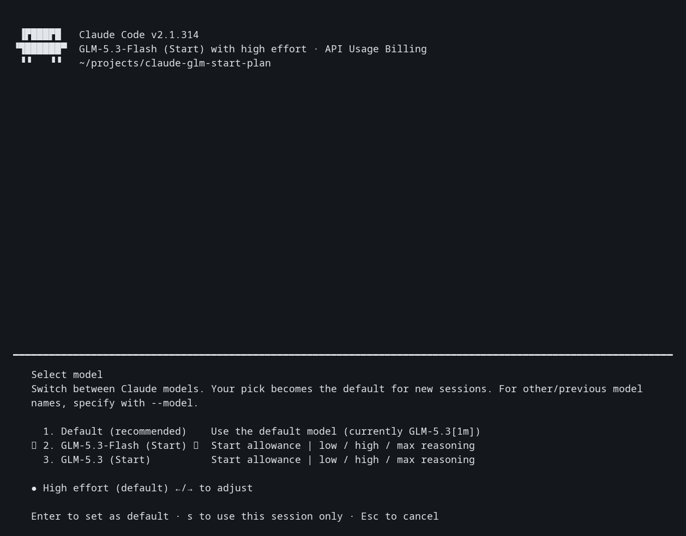
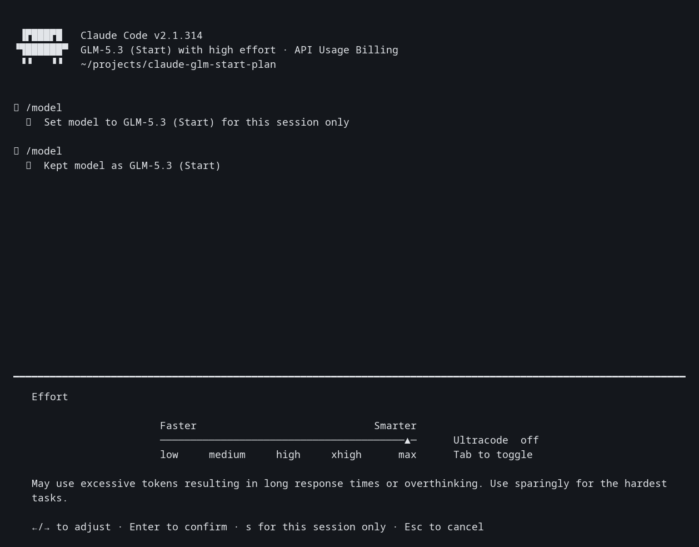

# Claude Code with GLM Start allowance

Run `claude-glm` to use GLM-5.3-Flash or GLM-5.3 inside the installed Claude Code application, using the Start allowance from the Z.ai account signed in to ZCode.

```sh
claude-glm
```

Open `/model` to select either model. Open `/effort` to select reasoning effort. Flash is the initial model.

The separately installed `zcode` command runs the source-built ZCode CLI with the same Start allowance. See [the CLI build and usage notes](docs/zcode-cli.md).

The model runs through Claude Code's tool execution, permissions, hooks, and session handling. No ZCode agent process runs in this path. The Start gateway requires ZCode system instructions, so the adapter includes two built-in ZCode instruction blocks and preserves Claude Code's original instructions in a system message inside the conversation. This is the compromise approved for this setup; it is not a Claude-instructions-only integration.

## Reasoning

The provider supports three effort values. Claude Code displays five, so the adapter maps them as follows.

| Claude Code selection | GLM request |
| --- | --- |
| low | low |
| medium | high |
| high | high |
| xhigh | max |
| max | max |

GLM thinking stays enabled. Claude Code's thinking-off toggle maps to low effort. There is no separate disabled-reasoning mode in the published GLM-5.3 configuration.

Both models have a declared 1,000,000-token context window. The launcher supplies that window to Claude Code while keeping automatic compaction enabled. Large-context behavior was not load-tested. Claude Code's dollar estimates are not the Start token-bucket balance; check the plan in ZCode for its real allowance and expiry.

## Install

Requirements: Node.js 22 or newer, Claude Code 2.1.314 or newer, and a signed-in Z.ai account in ZCode with an active Start allowance. Verified here with Node.js 26.12.1 and Claude Code 2.1.314. There are no npm dependencies for the adapter or Claude Code launcher; the separately built ZCode CLI has its own staged dependencies.

```sh
chmod +x bin/claude-glm.mjs
ln -s "$PWD/bin/claude-glm.mjs" "$HOME/.local/bin/claude-glm"
```

Run the link command from this checkout. If a command with that name already exists, inspect it before replacing it. The checkout must remain at its installed path.

Claude Code CLI arguments pass through:

```sh
claude-glm --model GLM-5.3 --effort max
claude-glm -p 'Explain this project'
claude-glm --resume
```

Use `claude-glm`, including for resuming these sessions. An ordinary `claude` command uses its ordinary profile.

## Local state and credentials

- The adapter reads the current `zcodejwttoken` from `~/.zcode/v2/credentials.json` for every request. It does not copy or rewrite the login.
- Inference goes only to `https://zcode.z.ai/api/v1/zcode-plan/anthropic/v1/messages`. There is no paid-plan fallback.
- The session listens on an ephemeral `127.0.0.1` port with a random local credential. It closes when Claude Code exits. No service runs between sessions.
- A private temporary settings file contains the local session credential, never the ZCode JWT. It is deleted on normal exit and SIGTERM. A forced SIGKILL can leave that small temporary directory; its credential is useless once its listener exits.
- Preferences, sessions, and memories use `~/.config/claude-glm/claude`. Initial preferences are copied once from the ordinary Claude settings. Instruction, hook, skill, agent, and plugin definitions are shared through links when present. The initial preference copy does not track later changes to the ordinary settings file.

Overrides: `CLAUDE_GLM_CLAUDE` selects the Claude executable; `CLAUDE_GLM_PROFILE` selects the dedicated profile directory. `ZCODE_DATA_BASE_DIR` and `ZCODE_CREDENTIAL_SECRET` follow ZCode's existing credential-store conventions.

To remove the launcher, remove its `~/.local/bin/claude-glm` link. Keep or back up the dedicated profile if its conversations matter. Removing the checkout or profile does not sign you out of ZCode.

## Verification

```sh
node --test
node scripts/smoke-live.mjs --live --tools
```

The first command is offline. The second explicitly consumes a small amount of Start allowance. It checks both models at low, high, and max; the medium/xhigh mappings; and a Bash tool round trip. See [recorded live results](docs/evidence/live-smoke.jsonl).

The actual Claude Code TUI was also used to select GLM-5.3, choose max effort, and send a prompt. The images below render captured terminal cells in a monochrome font; the adjacent text files contain the captured screen contents.





## Modules

```text
bin/claude-glm.mjs
  launcher.mjs     starts Claude and owns adapter cleanup
    profile.mjs   initializes the separate Claude profile
    proxy.mjs     authenticates local requests and streams the Start API
      credentials.mjs  reads the existing login per request
      protocol.mjs     preserves instructions/tools and maps effort
        zcode-prompt.mjs  supplies the required built-in blocks
```

The Start gateway currently rejects a normal Claude-only system prompt with HTTP 405 / code 3012. Adding Claude's system blocks after ZCode's top-level blocks is rejected too. Moving them to a conversation system message succeeds. This behavior was verified through real Claude Code requests, not inferred from an error message alone. The gateway can change, and the compatibility text/version headers are pinned to the installed ZCode 3.16.3 behavior.

See [the validation record](docs/validation.md) for the installed-command and native TUI checks.

References: [ZCode source](https://github.com/zai-org/ZCode), [Start account authentication](https://github.com/zai-org/ZCode/blob/main/packages/services/src/model-provider/accountProviderRequestAuthService.ts), [Claude Code model picker settings](https://code.claude.com/docs/en/settings-reference#modelpicker), and [custom context windows](https://code.claude.com/docs/en/model-config#correct-the-window-for-a-gateway-or-custom-model-id).
